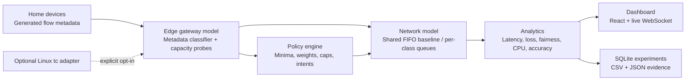

# Adaptive QoS Engine

A local dashboard and reproducible simulator for mixed residential broadband traffic. The simulator uses generated flow metadata only: it does not decrypt or inspect application payloads. Simulation measurements are labeled as synthetic and do not represent live WAN measurements.

## Architecture



The adapter is a separate opt-in integration. It requires Linux, `tc`, explicit confirmation, and an interface without a configured root qdisc. It installs a reversible HTB tree with `fq_codel` leaves. Only explicitly DSCP-marked packets match a service class; unmarked traffic goes to Unknown. Real `tc` changes were not run or validated on your computer while building this project.

## Reproducible setup (Windows PowerShell)

Tested with Python 3.11.6, Node.js 24.11.1, npm 11.6.2. Node dependencies are locked in `package-lock.json`; backend direct dependencies are pinned in `backend/requirements.txt`.

From the project folder:

```powershell
py -3.11 -m venv .venv
.\.venv\Scripts\Activate.ps1
python -m pip install --upgrade pip
python -m pip install -r backend\requirements.txt
npm ci
```

Start the backend in terminal 1:

```powershell
cd C:\Users\HP\Desktop\elx
.\.venv\Scripts\Activate.ps1
python -m uvicorn qos.main:app --app-dir backend --host 127.0.0.1 --port 8000
```

If Windows reports `[WinError 10013]`, port 8000 is unavailable or reserved. Find the process and choose a free port:

```powershell
$listener = Get-NetTCPConnection -LocalPort 8000 -State Listen -ErrorAction SilentlyContinue | Select-Object -First 1
if ($listener) { Get-Process -Id $listener.OwningProcess }
```

Stop that process only if you recognize it. Otherwise use another available port. For example, start the backend with `--port 8001`, then set `$env:VITE_BACKEND_PORT = "8001"` in terminal 2 before starting Vite; the HTTP and WebSocket proxies both use that setting.

Start the frontend in terminal 2 (leave backend running):

```powershell
cd C:\Users\HP\Desktop\elx
npm run dev
```

Open the local URL printed by Vite, normally `http://localhost:5173`. Check that `/api/health` returns `{"status":"ok", ...}` at `http://127.0.0.1:8000/api/health` (use port 8001 if you selected that alternative), then use **Experiment Lab → Run comparison**. The live dashboard should show `SIMULATED DATA`; results are stored in `backend/qos_history.sqlite3` by default. Set `$env:QOS_DB_PATH` before launching the backend to use another SQLite file.

## Project checks

From the repository root, install the pinned development tools, run the existing backend suite, and compile the frontend:

```powershell
python -m pip install -r backend\requirements-dev.txt
$env:PYTHONPATH = "backend"
python -m pytest backend\tests -q
npm run build
```

## Run a reproducible demo and save evidence

This command runs both policies against the same generated traffic, writes a full report and a row-per-tick CSV, and does not need the web server:

```powershell
cd C:\Users\HP\Desktop\elx\backend
..\.venv\Scripts\Activate.ps1
python -m qos.demo --scenario capacity_drop --seed 42 --ticks 40 --out ..\reports
```

Select `work_call_iso`, `capacity_drop`, `gaming_streams`, or `bulk_backup`. The JSON includes generated inputs, probe samples, classifier decisions, model settings, summaries, and raw time series. The generated `reports` directory is an output location; existing reports are not overwritten when a filename already exists.

## What the simulator measures

- **Classifier:** deterministic metadata rules use transport protocol, DSCP, destination port, packet size, packet rate, burstiness, duration, and observed flow rate. No payload is available to the classifier. Experiment accuracy is computed against generated labels and must not be interpreted as measured accuracy on real households.
- **Capacity:** noisy samples are processed by a median/EWMA estimator with fast downward response and slower upward response. The synthetic probe source observes the configured link capacity with bounded noise; a deployment would need a real probe or interface counter source.
- **Queue and QoE model:** one-second fluid arrivals, finite byte buffers, packet-size-derived queue counts, tail-drop loss, and propagation plus queueing delay. The baseline shares a FIFO queue and divides service in proportion to offered load. The adaptive arm uses separate class queues and the weighted policy. Jitter is the tick-to-tick change in modeled queueing delay; this is not packet-level jitter. Throughput and loss are modeled, not captured from a router.
- **Adaptation:** seconds to the first capacity estimate within 10% of the new configured link rate. A result of `N/A` means the experiment had no capacity step or did not settle during its run.
- **Fairness:** Jain index over active generated flows' served rates. **CPU/tick** is the local simulator process CPU time, not gateway hardware cost. **Allocation churn** is the average normalized change in per-class scheduled rates between ticks.
- **Comparison:** paired generated traffic, random seed, and initial capacity; baseline and adaptive policies differ. Reports aggregate p95 from all raw tick latencies instead of averaging rolling p95 values.

Scenario loads and impairments are defined in `backend/qos/traffic.py` and included in each report. A scenario is reproducible for a fixed seed and tick count; CPU time varies with host load. The fluid approximation does not model TCP congestion control, real packet timing, Wi-Fi contention, NAT, ISP shaping, flow encryption, multi-hop paths, or hardware offload.

## License notices

Direct third-party package names and license identifiers are listed in [THIRD_PARTY_NOTICES.md](THIRD_PARTY_NOTICES.md). Transitive JavaScript versions are recorded in `package-lock.json`; Python direct runtime and development dependencies are pinned separately.

## Known limitations and next validation steps

This project is a local competition prototype, not a deployed router control plane. The Linux adapter only supports a dedicated interface without an existing root qdisc and DSCP-marked packets; it does not identify apps on its own. Verify `flower` DSCP matching on the target Linux kernel and `tc` version in a disposable network namespace before using a lab interface. Next evidence needed for production claims: packet-level emulation with recorded impairment settings, real IPv4/IPv6 captures without payload decryption, larger independently labeled classifier datasets, repeated runs with confidence intervals, measured gateway CPU, fairness/starvation checks, and adaptation stability under noisy capacity changes. Keep policy bounds and rollback enabled for any later real-interface trial.
